# Advanced Hospitality Domain Vision & Strategic Capabilities

- **Document Identifier**: `DOC-ARCH-VISION-2026-001`
- **Authoritative Baseline**: [Reconciled 15-Phase Engineering Roadmap (Trello Backlog Authority)](../roadmap/15-phase-roadmap.md)
- **Status**: **AUTHORITATIVE ARCHITECTURAL VISION & DOMAIN STRATEGY**

---

## 1. Executive Summary & Strategic Mission

The current baseline of the Overlook Hotel (*MyBooking*) platform operates as an academic prototype: rooms have fixed prices, reservations represent single-room bookings, payments are nonexistent, loyalty points are a flat increment, and operational tasks are static database entries.

Modern hospitality platforms—such as Opera Cloud (Oracle Hospitality), Mews Systems, Cloudbeds, and luxury resort operating systems—operate with deeply sophisticated domain capabilities:
1. **Financial Precision**: Running guest folios, multi-party billing splits, dynamic deposits, and automated night audits.
2. **Dynamic Merchandising**: Add-on experiences, room-type upgrades, and dynamic yield pricing based on demand curves.
3. **Operational Autonomy**: Real-time room inspection workflows, housekeeping dispatch tied to guest arrival ETAs, and sensor-driven smart room environments.
4. **The Overlook Distinction**: AI-driven guest experience agents, autonomous robotic cleaning/delivery fleets, and themed historical resort experiences.

Crucially, **this vision is strictly aligned with our Reconciled 15-Phase Engineering Roadmap**. Rather than introducing ad-hoc features that destabilize the core monolith, this document provides the architectural blueprint for *when*, *where*, and *how* these capabilities will be introduced across our existing phases (specifically Phase 04 Bounded Contexts, Phase 06 C++ Pricing, Phase 09 Kafka Sagas, Phase 11 AI, Phase 12 IoT, Phase 13 Robotics, and Phase 14 Tauri).

---

## 2. Domain Modeling Implications & Conceptual Disambiguation

An essential objective of this analysis is to identify where our current v1 domain model conflates concepts that must be cleanly separated as we move into Phase 04 (Bounded Contexts & Schema Isolation).

```
Conceptual Disambiguation Matrix:
┌──────────────────────────────────────┬──────────────────────────────────────────────────────────────────┐
│ Conflated Baseline Concept           │ Correct Target Domain Separation                                 │
├──────────────────────────────────────┼──────────────────────────────────────────────────────────────────┤
│ 1. Reservation vs Stay               │ Reservation = Contractual booking; Stay = Physical guest visit   │
│ 2. Room vs Room Type vs Inventory    │ Room Type = Sellable category; Physical Room = Tangible unit     │
│ 3. Availability vs Occupancy vs Ready│ Availability = Calendar match; Occupancy = In-room; Ready = Clean│
│ 4. Booking vs Payment                │ Booking = Commitment; Payment = Financial settlement ledger      │
│ 5. Guest Account vs Guest Folio      │ Account = Identity & profile; Folio = Financial running invoice  │
│ 6. Balance vs Transaction Ledger     │ Balance = Current point total; Ledger = Immutable audit journal  │
│ 7. Event Booking vs Event Capacity   │ Booking = Ticket reservation; Capacity = Aggregate pool limiter  │
│ 8. Employee vs Shift vs Leave vs Task│ Worker = Resource; Shift = Time block; Task = Discrete action    │
│ 9. Housekeeping vs Maintenance       │ Housekeeping = Hygiene/readiness; Maintenance = Asset repair     │
│ 10. Property vs Tenant               │ Property = Physical hotel; Tenant = Corporate enterprise entity  │
└──────────────────────────────────────┴──────────────────────────────────────────────────────────────────┘
```

### 1. Reservation vs. Stay
- **Current Baseline Conflation**: The `reservation` table attempts to represent both the booking agreement made 6 months ago and the physical presence of the guest today.
- **Architectural Disambiguation**:
  - `Reservation`: The commercial agreement (dates requested, price quoted, guarantee status).
  - `Stay`: The physical in-hotel event created upon check-in. Tracks actual arrival/departure timestamps, keys issued, registered occupants, and room moves. A single reservation can have multiple stays if room reassignments occur.

### 2. Room vs. Room Type vs. Room Inventory
- **Current Baseline Conflation**: The `room` table defines room specifications, pricing, and physical units in one row. Guests book specific room numbers (`roomId = 101`).
- **Architectural Disambiguation**:
  - `RoomType`: The sellable catalog product (`DELUXE_KING`, `ALPINE_SUITE`, `GUEST_CABIN`). Defines default capacity, base pricing, and amenities.
  - `PhysicalRoom`: The tangible hotel room (`Room 217`, `Floor 2`, `Wing B`).
  - `RoomInventory`: Availability pooled by `RoomType` per date, matching how commercial OTAs (Booking.com, Expedia) book rooms.

### 3. Reservation Availability vs. Physical Occupancy vs. Operational Readiness
- **Current Baseline Conflation**: Single enum `RoomStatus` (`AVAILABLE`, `OCCUPIED`, `OUT_OF_SERVICE`).
- **Architectural Disambiguation**:
  - *Reservation Availability*: Purely dynamic calendar computation based on active reservation intervals.
  - *Physical Occupancy*: Real-time sensor or keycard status (`VACANT`, `OCCUPIED`).
  - *Operational Readiness*: Housekeeping workflow state (`DIRTY`, `CLEANING_IN_PROGRESS`, `CLEAN`, `INSPECTED`, `MAINTENANCE_HOLD`). A room cannot be occupied unless it is `INSPECTED`.

### 4. Booking vs. Payment
- **Current Baseline Conflation**: `Reservation` contains `totalPrice` with no payment records.
- **Architectural Disambiguation**:
  - `Booking`: The agreement to purchase accommodations.
  - `Payment`: An immutable monetary transaction (credit card authorization, capture, cash, bank transfer, refund) processed via a Payment Gateway with a unique transaction reference.

### 5. Guest Account vs. Guest Folio
- **Current Baseline Conflation**: In-room purchases or extras do not exist.
- **Architectural Disambiguation**:
  - `GuestAccount`: Long-lived identity record (email, hashed credentials, loyalty tier, preferences).
  - `GuestFolio`: A short-lived, transaction-safe accounting ledger created per stay. Line items (room charge, breakfast, spa session, bar tab) are posted to the folio. The folio is balanced to zero upon checkout.

### 6. Loyalty Account Balance vs. Loyalty Transaction Ledger
- **Current Baseline Conflation**: `balance` is updated directly in `LoyaltyAccount` without concurrency controls or reversal semantics.
- **Architectural Disambiguation**:
  - `LoyaltyLedger`: An immutable double-entry journal of point credits and debits (`EARN`, `REDEEM`, `CLAWBACK`, `EXPIRE`, `COMPENSATION`).
  - `LoyaltyBalance`: The materialized sum of all ledger entries for an account.

### 7. Event Booking vs. Event Capacity
- **Current Baseline Conflation**: Event capacity is an integer on `Event`, but bookings are confirmed without checking aggregate participant totals.
- **Architectural Disambiguation**:
  - `EventCapacityPool`: Thread-safe, atomic seat allocator tracking total seats, confirmed seats, and temporary holds.
  - `EventBooking`: Individual ticket confirmation referencing the allocated capacity.

### 8. Employee vs. Shift vs. Leave vs. Task
- **Current Baseline Conflation**: Tasks and shifts operate without unified calendar conflict validation against leave.
- **Architectural Disambiguation**:
  - `Employee`: Person with competencies and property assignment.
  - `Shift`: Time-bounded scheduled presence at the hotel.
  - `Leave`: Approved absence window with complete scheduling exclusion.
  - `Task`: Atomic unit of work (clean Room 217, inspect HVAC unit) assigned within an active shift.

### 9. Housekeeping vs. Maintenance
- **Current Baseline Conflation**: `OUT_OF_SERVICE` on `Room` is the only maintenance mechanism.
- **Architectural Disambiguation**:
  - `Housekeeping`: High-frequency hygiene and turnaround cycle.
  - `Maintenance`: Asset lifecycle, preventive inspections, work orders, out-of-order blocks, and IoT telemetry anomalies.

### 10. Property vs. Tenant
- **Current Baseline Conflation**: Single-property assumption throughout all database tables.
- **Architectural Disambiguation**:
  - `Tenant`: Corporate organization or management company (e.g., *Overlook Hospitality Group*).
  - `Property`: Physical hotel location (e.g., *The Overlook Resort & Spa — Estes Park*, *Overlook Lodge — Aspen*).

---

## 3. Category A: Industry-Standard Hospitality Capabilities

### CAP-IND-001: Guest Folio & Split Billing Engine
1. **Business Problem**: Guests cannot charge incidental amenities (dining, spa, parking) to their room, nor can travel companions split lodging expenses.
2. **Target Users**: Hotel Front Desk Agents, Night Auditors, Guests.
3. **Main Workflows**:
   - Check-in: Create open Folio associated with Reservation. Pre-authorize credit card for room + incidentals.
   - During Stay: Post point-of-sale charges (room service, gift shop) directly to Room Folio.
   - Check-out: Split folio balance 50/50 between two guest credit cards, capture funds, balance to zero, generate fiscal invoice.
4. **Functional Requirements**:
   - Folio line items must include timestamp, category, amount, tax, and posting user.
   - Folio cannot be closed if balance $\ne 0$.
5. **Domain Entities**: `Folio`, `FolioCharge`, `FolioPayment`, `BillingSplit`.
6. **Candidate Bounded Context**: `Billing & Financial Operations`.
7. **Data Ownership**: Owned strictly by Billing context; read-only reference to `reservation_id`.
8. **Required Integrations**: Payment Gateway (Stripe/Adyen), Point of Sale (POS) API.
9. **Security & Privacy**: PCI-DSS compliance; no plain-text PAN storage.
10. **Dependencies**: None (Java/Spring Boot).
11. **Complexity**: High.
12. **Business Value**: Critical (mandatory for real-world hotel operations).
13. **Portfolio Value**: High (demonstrates enterprise financial ledger modeling).
14. **Priority**: **Must Have**.
15. **Recommended Phase**: **Phase 04 (Schema Isolation)** for entity modeling, **Phase 09 (Sagas)** for distributed payment settlement.

---

### CAP-IND-002: Multi-Room & Group Reservations
1. **Business Problem**: Families or corporate groups cannot book multiple rooms under a single confirmation code without creating separate accounts.
2. **Target Users**: Corporate bookers, families, wedding planners.
3. **Main Workflows**: Master booking created $\rightarrow$ Sub-reservations allocated with room types $\rightarrow$ Guest names assigned per room $\rightarrow$ Unified confirmation issued.
4. **Functional Requirements**: Support master reservation ID, group billing, and bulk check-in.
5. **Domain Entities**: `GroupReservation`, `MasterBooking`, `RoomAllocation`.
6. **Candidate Bounded Context**: `Booking`.
7. **Data Ownership**: Booking context.
8. **Required Integrations**: None.
9. **Security & Privacy**: GDPR guest data consent.
10. **Dependencies**: None.
11. **Complexity**: Medium.
12. **Business Value**: High.
13. **Portfolio Value**: Medium.
14. **Priority**: **Should Have**.
15. **Recommended Phase**: **Phase 04 (Bounded Contexts)**.

---

### CAP-IND-003: Reservation Add-ons & Upselling Engine
1. **Business Problem**: Hotels lose substantial high-margin revenue by not offering ancillary services (breakfast, early check-in, late checkout, valet parking) during booking.
2. **Target Users**: Online Guests, Front Desk Staff.
3. **Main Workflows**: Guest selects room $\rightarrow$ Booking flow displays dynamic add-ons $\rightarrow$ Selected add-ons attached to reservation $\rightarrow$ Add-on charges posted to Guest Folio.
4. **Functional Requirements**: Time-restricted add-ons (e.g. early check-in subject to room readiness).
5. **Domain Entities**: `AddOnService`, `ReservationAddOn`, `ServiceSchedule`.
6. **Candidate Bounded Context**: `Inventory` & `Booking`.
7. **Data Ownership**: Inventory owns service catalog; Booking owns reservation associations.
8. **Required Integrations**: Housekeeping dispatch.
9. **Security & Privacy**: Standard.
10. **Dependencies**: None.
11. **Complexity**: Medium.
12. **Business Value**: High.
13. **Portfolio Value**: Medium.
14. **Priority**: **Should Have**.
15. **Recommended Phase**: **Phase 04 (Bounded Contexts)**.

---

### CAP-IND-004: Tiered Loyalty Engine with Dynamic Multipliers
1. **Business Problem**: Current loyalty gives flat 1 point per dollar with no tiers, tier progression, or milestone incentives.
2. **Target Users**: Frequent Guests, Corporate VIPs.
3. **Main Workflows**: Guest completes stay $\rightarrow$ Points calculated with tier multiplier $\rightarrow$ Tier status updated annually $\rightarrow$ Milestone rewards unlocked.
4. **Functional Requirements**:
   - Tiers: `SILVER` (1.0x), `GOLD` (1.25x), `PLATINUM` (1.5x), `OVERLOOK_AMBASSADOR` (2.0x).
   - Point expiration after 18 months of inactivity.
5. **Domain Entities**: `LoyaltyTier`, `TierProgress`, `LoyaltyReward`, `PointsExpiryJob`.
6. **Candidate Bounded Context**: `Loyalty`.
7. **Data Ownership**: Loyalty context.
8. **Required Integrations**: Event streaming (Phase 05 Outbox / Phase 09 Kafka).
9. **Security & Privacy**: Standard.
10. **Dependencies**: None.
11. **Complexity**: Medium.
12. **Business Value**: High.
13. **Portfolio Value**: High.
14. **Priority**: **Should Have**.
15. **Recommended Phase**: **Phase 04 / Phase 05**.

---

### CAP-IND-005: Operational Housekeeping & Room Inspection Workflows
1. **Business Problem**: Housekeeping staff have no structured workflow to mark rooms as `DIRTY`, `CLEAN`, or `INSPECTED`. Rooms cannot be safely verified before guest arrival.
2. **Target Users**: Housekeeping Staff, Floor Supervisors, Front Desk.
3. **Main Workflows**: Guest checks out $\rightarrow$ Room automatically transitions to `DIRTY` $\rightarrow$ Task dispatched to housekeeper $\rightarrow$ Housekeeper marks `CLEAN` $\rightarrow$ Supervisor inspects and marks `INSPECTED` $\rightarrow$ Front desk checks in new guest.
4. **Functional Requirements**: Room cannot be checked into unless status is `INSPECTED`.
5. **Domain Entities**: `HousekeepingTask`, `RoomInspection`, `CleaningChecklist`.
6. **Candidate Bounded Context**: `Operations / Staff`.
7. **Data Ownership**: Operations context.
8. **Required Integrations**: Staff Desktop Workstation (Phase 14 Tauri).
9. **Security & Privacy**: Staff role-based authorization (`EMPLOYEE`).
10. **Dependencies**: Phase 14 Tauri.
11. **Complexity**: Medium.
12. **Business Value**: Critical.
13. **Portfolio Value**: High.
14. **Priority**: **Must Have**.
15. **Recommended Phase**: **Phase 04 (Schema Isolation)** & **Phase 14 (Tauri Desktop Workstation)**.

---

### CAP-IND-006: Ancillary Inventory, Dining & Outlets Management (Restaurants, Menus, Spa)
1. **Business Problem**: Add-ons, experiences, and dining are currently modeled as abstract strings without connection to tangible resort inventory, physical outlets, menus, seat capacities, or staff availability.
2. **Target Users**: Food & Beverage Managers, Spa Directors, Front Desk, Guests.
3. **Main Workflows**:
   - Outlet Management: Admin configures outlets (*The Timberline Restaurant*, *Gold Room Lounge*, *Overlook Alpine Spa*), operating hours, and meal periods (Breakfast, Lunch, Dinner).
   - Menu & Service Catalog: Chef publishes seasonal menus with item descriptions, prices, allergens, and dietary tags (Gluten-Free, Vegan).
   - Capacity Allocation: Dining reservations enforce table/seat covers per 30-minute seating window; spa bookings enforce treatment room and therapist availability.
   - Point-of-Sale Billing: Waitstaff post dining bills directly to guest room numbers, validating active stay status and posting charges to `GuestFolio`.
4. **Functional Requirements**:
   - Support finite inventory/seat caps per time slot.
   - Real-time charge verification against active `GuestFolio`.
   - Admin dashboards for real-time menu management, 86'd items (out-of-stock), and daily cover reports.
5. **Domain Entities**: `Outlet`, `OutletType`, `MenuItem`, `MenuCategory`, `DiningReservation`, `SpaService`, `SpaTreatmentRoom`.
6. **Candidate Bounded Context**: `Inventory & Outlets Bounded Context` (Phase 04).
7. **Data Ownership**: Inventory owns outlets, menus, and capacity; Billing owns folio charges.
8. **Required Integrations**: Point-of-Sale (POS) API, Guest Folio (`CAP-IND-001`), Kitchen Display System (KDS).
9. **Security & Privacy**: Staff RBAC (`EMPLOYEE`, `ADMIN`); guest dining preferences protected under GDPR.
10. **Dependencies**: Phase 04 schema isolation.
11. **Complexity**: High.
12. **Business Value**: Very High (major revenue center for resort hotels).
13. **Portfolio Value**: High (demonstrates complex multi-outlet inventory modeling).
14. **Priority**: **Should Have**.
15. **Recommended Phase**: **Phase 04 (Modular Monolith Bounded Contexts & Schema Isolation)**.

---

## 4. Category B: Overlook Differentiating Capabilities

### CAP-DIFF-001: AI Guest Concierge & Experience Copilot
1. **Business Problem**: Guests wait in line at front desk or call reception for basic questions regarding hotel history, local mountain trails, dining reservations, or amenities.
2. **Target Users**: In-house and pre-arrival guests on Web and Mobile.
3. **Main Workflows**: Guest chats via portal $\rightarrow$ AI agent answers queries with RAG context (hotel amenities, menu, Estes Park weather) $\rightarrow$ Agent offers to book hotel events or dinner with human guard verification.
4. **Functional Requirements**: Strict deterministic policy guard against prompt injection; cannot execute booking without guest confirmation.
5. **Domain Entities**: `AiConversationSession`, `AgentAuditLog`, `PolicyGuardrail`.
6. **Candidate Bounded Context**: `AI Platform`.
7. **Data Ownership**: Autonomous AI agent service.
8. **Required Integrations**: OpenAI / Gemini API, Internal Service Tool APIs.
9. **Security & Privacy**: Guest data sanitization; zero PII leakage into external LLM prompts.
10. **Dependencies**: **Phase 11 (AI Agent Platform & Deterministic Policy Guard Layer)**.
11. **Complexity**: High.
12. **Business Value**: Very High.
13. **Portfolio Value**: Exceptional.
14. **Priority**: **Must Have** (for Phase 11).
15. **Recommended Phase**: **Phase 11**.

---

### CAP-DIFF-002: Smart-Room Personalization & Pre-Arrival Configuration
1. **Business Problem**: Luxury resort guests expect customized room environments upon arrival rather than generic, cold rooms.
2. **Target Users**: VIP Guests, Hotel Operations, Facilities Engineering.
3. **Main Workflows**: Guest configures preferences in web profile (21°C temperature, warm ambient lighting, relaxing jazz playlist) $\rightarrow$ 60 minutes before guest arrival ETA, system dispatches MQTT command $\rightarrow$ Room prepares environment $\rightarrow$ Guest enters personalized room.
4. **Functional Requirements**: Bidirectional telemetry; fallback to manual thermostat controls.
5. **Domain Entities**: `RoomEnvironmentPreference`, `DeviceTelemetry`, `RoomDeviceState`.
6. **Candidate Bounded Context**: `IoT & Smart Room Edge`.
7. **Data Ownership**: Owned by Rust IoT Edge Gateway; preferences read from Guest Profile.
8. **Required Integrations**: MQTT Protocol Bridge, TimescaleDB.
9. **Security & Privacy**: Device mutual TLS (mTLS); local gateway token verification.
10. **Dependencies**: **Phase 12 (Rust IoT Edge Gateway & Smart Room Telemetry)**.
11. **Complexity**: High.
12. **Business Value**: Very High.
13. **Portfolio Value**: Exceptional.
14. **Priority**: **Must Have** (for Phase 12).
15. **Recommended Phase**: **Phase 12**.

---

### CAP-DIFF-003: Autonomous Housekeeping & Delivery Robotics Fleet Management
1. **Business Problem**: Transporting fresh linens, room amenities, and minibar restocks across large resort wings consumes hundreds of staff hours.
2. **Target Users**: Housekeeping Managers, Autonomous Robots, Hotel Guests.
3. **Main Workflows**: Guest requests extra towels $\rightarrow$ Front desk approves $\rightarrow$ Task dispatched to autonomous robot $\rightarrow$ Robot navigates corridors and elevators using ROS 2 $\rightarrow$ Arrives at room door and notifies guest via SMS/App $\rightarrow$ Guest retrieves towels $\rightarrow$ Robot returns to dock.
4. **Functional Requirements**: Geofence safety boundaries; elevator integration; emergency stop.
5. **Domain Entities**: `RobotUnit`, `FleetMission`, `CorridorWaypoint`, `SafetyGeofence`.
6. **Candidate Bounded Context**: `Robotics & Autonomous Fleet`.
7. **Data Ownership**: Autonomous ROS 2 service.
8. **Required Integrations**: ROS 2 Navigation Stack (Nav2), Room Telemetry.
9. **Security & Privacy**: Hardware security module (HSM) attestation; zero video streaming to public networks.
10. **Dependencies**: **Phase 13 (ROS 2 Autonomous Robot & Drone Fleet Management)**.
11. **Complexity**: Very High.
12. **Business Value**: High.
13. **Portfolio Value**: Cutting-Edge / Flagship Showcase.
14. **Priority**: **Must Have** (for Phase 13).
15. **Recommended Phase**: **Phase 13**.

---

### CAP-DIFF-004: Themed Overlook Experiences & Curated Lore Packages
1. **Business Problem**: Standard hotel apps treat rooms as generic square footage; the historic Overlook Hotel has iconic lore, historical ballrooms, and mountain resort activities.
2. **Target Users**: Leisure travelers, horror literature fans, luxury event organizers.
3. **Main Workflows**: Guest books "The Colorado Suite Experience" $\rightarrow$ Package automatically bundles: historic room stay + Hedge Maze evening lantern tour + Gold Room signature banquet + commemorative book.
4. **Functional Requirements**: Composite packages combining room inventory + activity bookings + merchandise voucher.
5. **Domain Entities**: `CuratedPackage`, `ExperienceBundle`, `ActivityTicket`.
6. **Candidate Bounded Context**: `Events & Marketing`.
7. **Data Ownership**: Marketing & Events context.
8. **Required Integrations**: Reservation and Event booking engines.
9. **Security & Privacy**: Standard.
10. **Dependencies**: None.
11. **Complexity**: Medium.
12. **Business Value**: Very High.
13. **Portfolio Value**: High.
14. **Priority**: **Should Have**.
15. **Recommended Phase**: **Phase 04 (Bounded Contexts)**.

---

## 5. Category C: Additional Original Opportunities

### CAP-ORIG-001: Dynamic Yield Pricing Engine with Machine Learning Forecasting
* **Description**: Real-time room rate optimization using numerical solvers and linear programming.
* **Target Users**: Hotel Revenue Manager, Automated Ingress.
* **Architecture**: C++20 matrix solver integrated via gRPC.
* **Traceability**: **Phase 06: C++20 Dynamic Pricing & Yield Engine Integration**.

### CAP-ORIG-002: Real-time High-Concurrency Availability Bitset Index
* **Description**: Sub-millisecond room availability search handling 5,000+ searches/sec during peak flash sales.
* **Architecture**: Go microservice backed by Redis bitset calendar indices.
* **Traceability**: **Phase 07: Go Availability Search & Edge API Gateway**.

### CAP-ORIG-003: Operational Hotel Analytics & WORM Audit Trail
* **Description**: Sub-second RevPAR, ADR, and occupancy aggregations across millions of rows, combined with SEC/GDPR-compliant WORM audit storage.
* **Architecture**: Go streaming pipeline, ClickHouse OLAP, MinIO/S3 Object Lock.
* **Traceability**: **Phase 10: Database-per-Service Migration & Analytics Service in Go (ADR-0014, ADR-0020)**.

---

## 6. High-Load Architecture Strategy & Concurrency Engineering under Seasonal Peaks

A critical architectural distinction must be maintained between **High Performance** (raw execution speed of a single operation, e.g. C++ dynamic pricing in $< 15$ ms) and **High Load / High Concurrency** (system resilience, throughput, and correctness when thousands of guests and booking engines hit the platform simultaneously during flash sales, ski season openings, or summer peak rushes).

### 6.1 The Hospitality Load Profile: 100:1 Read-to-Write Ratio
Hospitality platforms experience an asymmetric traffic profile:
- **Search Traffic (Read Heavy)**: For every 1 completed booking, there are 80 to 150 availability searches and room comparisons.
- **Booking Creation (Write Heavy & Contentious)**: Highly contended writes on specific high-demand room categories (e.g. *The Presidential Suite* for New Year's Eve, or standard rooms during a flash discount).

```
High-Load Traffic Shaping Topology:
┌────────────────────────────────────────────────────────────────────────────────────────┐
│ Ingress Layer (Edge Gateway - Phase 07)                                                │
│ • Token Bucket Rate Limiting (Protects downstream from DDoS & bot scraping)            │
│ • Virtual Waiting Room / Admission Control during Flash Sales                          │
└───────────────────────────┬────────────────────────────────────────────────────────────┘
                            │
              ┌─────────────┴─────────────┐
              │ Reads (99%)               │ Writes (1%)
              ▼                           ▼
┌───────────────────────────────┐   ┌────────────────────────────────────────────────────┐
│ Availability Search Engine    │   │ Transactional Booking Core                         │
│ (Go + Redis Bitset - Phase 07)│   │ (Spring Boot / PostgreSQL - Phase 03/04)           │
│ • Sub-millisecond bitset math │   │ • Pessimistic row-lock (SELECT ... FOR UPDATE)     │
│ • Zero PostgreSQL DB hits     │   │ • 15-Minute Redis Distributed Lease (Hold)         │
│ • 10,000+ searches/second     │   │ • Minimal lock duration (< 5 ms per transaction)   │
└───────────────────────────────┘   └─────────────────────────┬──────────────────────────┘
                                                              │ Emits Outbox Event
                                                              ▼
                                    ┌────────────────────────────────────────────────────┐
                                    │ Asynchronous Event Pipeline (Phase 05 / Phase 09)  │
                                    │ • Outbox Relay -> Kafka Topic Topology             │
                                    │ • Non-blocking Loyalty, Analytics, Notifications   │
                                    └────────────────────────────────────────────────────┘
```

### 6.2 Concurrency Engineering: Pessimistic Row Locking vs. Performance
To eliminate double bookings (`INV-RES-001`), Phase 03 introduces pessimistic locking (`SELECT ... FOR UPDATE` on `Room`). However, pessimistic locks can become performance bottlenecks if misapplied:

1. **Granularity: Row Lock vs. Table Lock**:
   - The query locks **only the specific physical `Room` row** being booked (`WHERE r.id = :roomId`). It never locks the entire table or category. Other guests booking different rooms execute completely in parallel without contention.
2. **Lock Duration Minimization**:
   - The transaction boundary must be kept strictly minimal:
     $$\text{Transaction Start} \rightarrow \text{Pessimistic Read Room} \rightarrow \text{Verify Overlap} \rightarrow \text{Insert Reservation} \rightarrow \text{Commit}$$
   - **Zero external network calls** (no payment gateway, no email sending, no third-party APIs) are permitted inside the locked transaction. Under HikariCP connection pooling, the lock duration is $< 4$ ms.
3. **The 15-Minute Temporary Hold (`PENDING_PAYMENT`) Pattern**:
   - For high-load seasonal sales, instead of holding database locks while a guest types their credit card numbers, the system places a **15-minute distributed lease in Redis** (`SET room:{id}:dates:{range} holder_token EX 900 NX`).
   - If payment completes within 15 minutes, the booking commits to PostgreSQL. If the lease expires, the room is released back to inventory automatically without database transaction overhead.

### 6.3 Asynchronous Side-Effect Offloading (CQRS & Transactional Outbox)
Under high load, a synchronous booking endpoint that attempts to update loyalty points, send emails, generate PDF vouchers, and update analytics will exhaust the servlet thread pool and database connections.
- **Phase 05 (Transactional Outbox)**: State changes commit locally with an outbox record in a single transaction.
- **Phase 09 (Kafka Sagas)**: Asynchronous consumers handle loyalty point accrual, guest notifications, and telemetry dispatch in background worker pools.

### 6.4 Verification under Load: Automated k6 Stress Testing
To guarantee that the platform functions correctly under seasonal peaks:
- In **Phase 15 (DevSecOps)**, we deploy distributed **k6 load test scripts** simulating:
  - 10,000 concurrent availability search queries/second ($p99 < 50$ ms).
  - 500 concurrent booking attempts targeting the *exact same room* $\rightarrow$ **Exactly 1 succeeds with 200 OK, 499 receive 409 Conflict / 400 Bad Request, with zero double-bookings and zero deadlocks**.

---

## 7. Comprehensive Roadmap Traceability Matrix

Every proposed capability maps strictly into our existing 15-phase sequence:

| Capability ID | Capability Title | Category | Existing Roadmap Phase | Scope Impact | Implementation Timing |
| :--- | :--- | :--- | :--- | :--- | :--- |
| `CAP-IND-001` | Guest Folio & Split Billing | Standard | **Phase 04 / Phase 09** | Add entity in P4, Saga in P9 | Schema in Phase 4 |
| `CAP-IND-002` | Multi-Room Reservations | Standard | **Phase 04** | Model in Bounded Context | Phase 4 |
| `CAP-IND-003` | Add-ons & Upselling Engine | Standard | **Phase 04** | Model in Bounded Context | Phase 4 |
| `CAP-IND-004` | Tiered Loyalty Engine | Standard | **Phase 04 / Phase 05** | Model in Bounded Context | Phase 4 / 5 |
| `CAP-IND-005` | Housekeeping & Room Inspection | Standard | **Phase 04 / Phase 14** | Model in P4, UI in P14 | Phase 4 & Phase 14 |
| `CAP-IND-006` | Ancillary Inventory, Dining & Spa | Standard | **Phase 04** | Model Outlets & Menus | Phase 4 |
| `CAP-DIFF-001`| AI Guest Concierge & Copilot | Overlook | **Phase 11** | Core deliverable of Phase 11 | Phase 11 |
| `CAP-DIFF-002`| Smart-Room IoT Personalization | Overlook | **Phase 12** | Core deliverable of Phase 12 | Phase 12 |
| `CAP-DIFF-003`| Housekeeping Robotics Fleet | Overlook | **Phase 13** | Core deliverable of Phase 13 | Phase 13 |
| `CAP-DIFF-004`| Themed Experience Packages | Overlook | **Phase 04** | Model in Events Context | Phase 4 |
| `CAP-ORIG-001`| Dynamic Yield Pricing | Original | **Phase 06** | Core deliverable of Phase 6 | Phase 6 |
| `CAP-ORIG-002`| Go Availability Search & High Load | Original | **Phase 07** | Core deliverable of Phase 7 | Phase 7 |
| `CAP-ORIG-003`| ClickHouse Analytics & WORM | Original | **Phase 10** | Core deliverable of Phase 10 | Phase 10 |

---

## 8. Strategic Synthesis & Phased Implementation Path

```mermaid
flowchart TD
    subgraph Monolith Stabilization [Immediate Steps]
        P3["Phase 03: Domain Refactoring & Reservation Core Fixes<br/>• Fix Reservation overlap, Event capacity, Loyalty clawback, Room decoupling"]
        IDP["Milestone IdP: Keycloak + Next.js BFF + Public UUIDv7<br/>• Asymmetric tokens, zero localStorage, non-enumerable UUIDv7"]
    end

    subgraph Modular Monolith Evolution [Phase 04 - 05]
        P4["Phase 04: Bounded Contexts & Schema Isolation<br/>• Model Folios, Add-ons, Housekeeping readiness, Loyalty Tiers, Experience bundles<br/>• Isolated PostgreSQL schemas (auth, inventory, booking, loyalty, operations)"]
        P5["Phase 05: Transactional Outbox & Domain Events<br/>• Decouple state mutations from asynchronous side-effects"]
    end

    subgraph Specialized Polyglot Extractions [Phase 06 - 15]
        P6["Phase 06: C++20 Dynamic Pricing Engine (gRPC)"]
        P7["Phase 07: Go Availability Search & Edge Gateway (Redis)"]
        P9["Phase 09: Distributed Event Streaming & Sagas (Kafka, Payment Svc)"]
        P10["Phase 10: Go Analytics & ClickHouse OLAP (WORM S3)"]
        P11["Phase 11: AI Agent Platform & Policy Guard Layer"]
        P12["Phase 12: Rust IoT Edge Gateway & Smart Rooms"]
        P13["Phase 13: ROS 2 Autonomous Robotics Fleet"]
        P14["Phase 14: Rust + Tauri Desktop Workstation"]
        P15["Phase 15: Kubernetes DevSecOps & Production Hardening"]
    end

    P3 --> IDP
    IDP --> P4
    P4 --> P5
    P5 --> P6
    P6 --> P7
    P7 --> P9
    P9 --> P10
    P10 --> P11
    P11 --> P12
    P12 --> P13
    P13 --> P14
    P14 --> P15
```



### Strategic Conclusion
By maintaining this exact architectural sequence, we eliminate technical debt in Phase 03, establish enterprise IAM and anti-enumeration in Milestone IdP, model rich hospitality business concepts in Phase 04 without legacy debt, and extract specialized high-performance microservices in Phases 06–15 with zero architectural drift.

