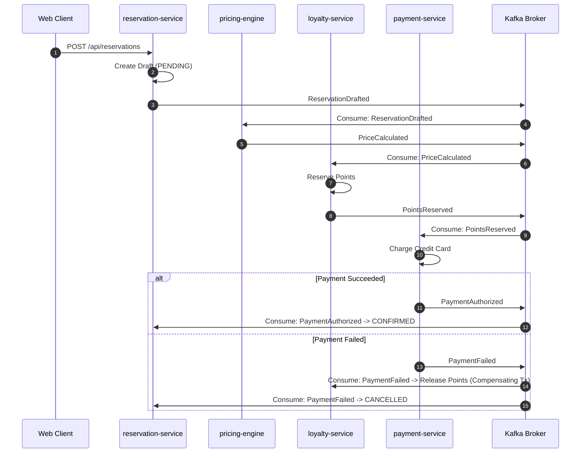

# Distributed Transactions & Saga Architecture

## 1. Overview
In a database-per-service architecture, business operations crossing service boundaries cannot use traditional 2-Phase Commit (2PC) due to availability and locking overhead. MyBooking utilizes **Saga Choreography and Orchestration** patterns with eventual consistency.

## 2. Representative Saga Workflows

## 3. Compensation & Reconciliation
* Every action step in a Saga must define a corresponding **Compensating Transaction** (e.g. `ReservePoints` -> `ReleasePoints`).
* An automated background **Reconciliation Scheduler** periodically compares pending draft reservations older than 15 minutes and issues cancellation compensating events if payment was never received.
