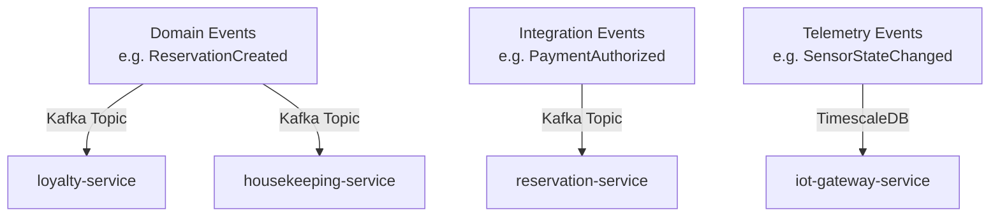

# Event-Driven Architecture Specification

## 1. Messaging Infrastructure
* **Event Broker**: Apache Kafka / Redpanda Cluster.
* **Serialization Format**: Protocol Buffers (Protobuf) or JSON Schema with schema registry validation.
* **Partitioning**: Partitioned by `property_id` or `reservation_id` to guarantee strict event ordering per context.

## 2. Event Taxonomy

## 3. Guarantees & Resilience Patterns
1. **Transactional Outbox Pattern**: State mutations and event publishing occur within a single database transaction using a local `outbox` table.
2. **Idempotent Consumers**: Consumers log incoming `event_id`s in an `inbox` table to ignore duplicate deliveries.
3. **Dead Letter Queue (DLQ)**: Messages that fail processing after 3 retries are sent to a DLQ for manual inspection and replay.
