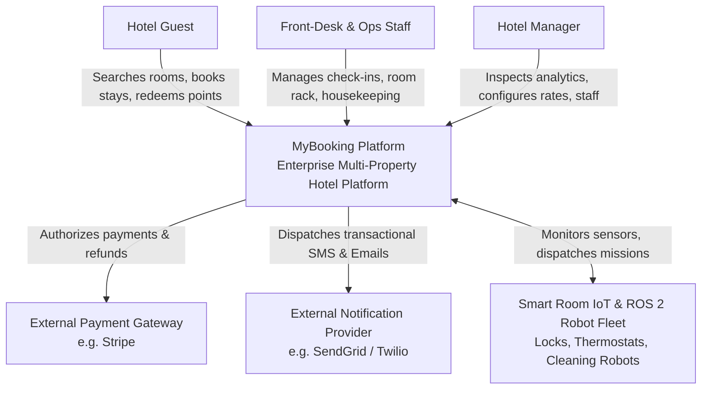

# C4 Architecture Specification: System Context & Container Model

This document specifies the **C4 Level 1 (System Context)** and **C4 Level 2 (Container Diagram)** for the MyBooking Platform, locking in the official **13-Microservice Topology**.

---

## 1. Actors & External Systems

| Actor / System | Description | Interfaces |
| :--- | :--- | :--- |
| **Hotel Guest** | End-user booking rooms, exploring facilities, using loyalty points, checking in/out. | Next.js Web App / Mobile Web |
| **Hotel Front-Desk Staff** | Hotel employee managing guest check-ins, room rack, keycard encoding, and folio billing. | Rust + Tauri Desktop Workstation App |
| **Hotel Manager / Administrator** | Property executive inspecting RevPAR, ADR, staff schedules, and pricing rules. | Rust + Tauri Desktop App / Web Admin |
| **Housekeeping & Maintenance** | Operational personnel executing room cleaning tasks and logging maintenance status. | Rust + Tauri Mobile/Desktop PWA |
| **Autonomous Robots & Drones** | ROS 2 physical robots performing automated room cleaning, delivery, and inspection. | ROS 2 Nav2 / PX4 via IoT Edge Gateway |
| **Payment Gateway (External)** | External payment provider (e.g. Stripe) authorizing credit card charges and refunds. | Webhooks / HTTPS REST |
| **External Communication Providers**| Third-party SMS/Email gateways (Twilio, SendGrid) delivering guest notifications. | HTTPS REST API |

---

## 2. C4 Level 1: System Context Diagram



---

## 3. C4 Level 2: Container Diagram (The 13 Microservices Topology)

```mermaid
graph TD
    subgraph Client Applications Tier
        WebGuest["Next.js 14 Web App<br/>(Guest Booking & Catalog)"]
        TauriDesk["Rust + Tauri Desktop App<br/>(Staff Workstations & Keycard Encoder)"]
    end

    subgraph Ingress & Gateway Tier [Service 1]
        APIGateway["1. edge-api-gateway (Go)<br/>TLS, Reverse Proxy, Token Relay, Rate Limiter"]
    end

    subgraph Core Transactional Business Services (Java 17 / Spring Boot 3) [Services 2-8]
        IdentitySvc["2. identity-service<br/>OAuth2 / OIDC Auth, RBAC"]
        InventorySvc["3. inventory-service<br/>Room & Facility Catalog"]
        ReservationSvc["4. reservation-service<br/>Booking Engine & Stay Records"]
        LoyaltySvc["5. loyalty-service<br/>Points Ledger & Rewards"]
        HousekeepingSvc["6. housekeeping-service<br/>Cleanliness Status & Staff Tasks"]
        PaymentSvc["7. payment-service<br/>Billing & Payment Gateway Adapter"]
        NotificationSvc["8. notification-service<br/>Multi-Channel Comms Dispatcher"]
    end

    subgraph High-Performance Engines [Services 9-11]
        PricingEngine["9. pricing-engine (C++20)<br/>Dynamic Yield Matrix Solver (gRPC)"]
        SearchEngine["10. availability-search (Go)<br/>High-Concurrency Availability Query"]
        AnalyticsSvc["11. analytics-service (Go)<br/>RevPAR, ADR & ClickHouse Stream Ingestion"]
    end

    subgraph Autonomous Physical & Edge Tier [Services 12-13]
        IoTGateway["12. iot-gateway-service (Rust)<br/>MQTT Broker Bridge & Smart Lock Telemetry"]
        RobotFleet["13. robot-fleet-service (Rust)<br/>ROS 2 Task Scheduler & Safety Geofence"]
    end

    subgraph Event Streaming & Polyglot Persistence Tier
        KafkaBus[Apache Kafka / Redpanda Event Bus]
        PostgresDB[(PostgreSQL 14 DBs<br/>Database-per-Service)]
        RedisCache[(Redis 7 Cache<br/>Search Index & Distributed Locks)]
        TimescaleDB[(TimescaleDB<br/>High-Frequency IoT Telemetry)]
        ClickHouseDB[(ClickHouse OLAP<br/>Analytics & Audit Logs)]
    end

    %% Client Interactions
    WebGuest -->|HTTPS / REST| APIGateway
    TauriDesk -->|gRPC / REST| APIGateway

    %% Gateway Routing
    APIGateway --> IdentitySvc
    APIGateway --> ReservationSvc
    APIGateway --> SearchEngine
    APIGateway --> HousekeepingSvc
    APIGateway --> LoyaltySvc
    APIGateway --> AnalyticsSvc

    %% Service to Service synchronous
    ReservationSvc <-->|gRPC| PricingEngine
    SearchEngine <--> RedisCache

    %% Database connections
    IdentitySvc --> PostgresDB
    InventorySvc --> PostgresDB
    ReservationSvc --> PostgresDB
    LoyaltySvc --> PostgresDB
    HousekeepingSvc --> PostgresDB
    PaymentSvc --> PostgresDB
    NotificationSvc --> PostgresDB
    IoTGateway --> TimescaleDB
    AnalyticsSvc --> ClickHouseDB

    %% Event Bus Connections
    ReservationSvc --> KafkaBus
    LoyaltySvc <--> KafkaBus
    HousekeepingSvc <--> KafkaBus
    PaymentSvc <--> KafkaBus
    NotificationSvc <--> KafkaBus
    IoTGateway --> KafkaBus
    RobotFleet <--> KafkaBus
    KafkaBus --> AnalyticsSvc

    %% Physical Hardware Communication
    IoTGateway <-->|MQTT over TLS| PhysicalHardware[Smart Locks, Sensors & Robots]
    RobotFleet <-->|ROS 2 Nav2 / PX4| PhysicalHardware
```
